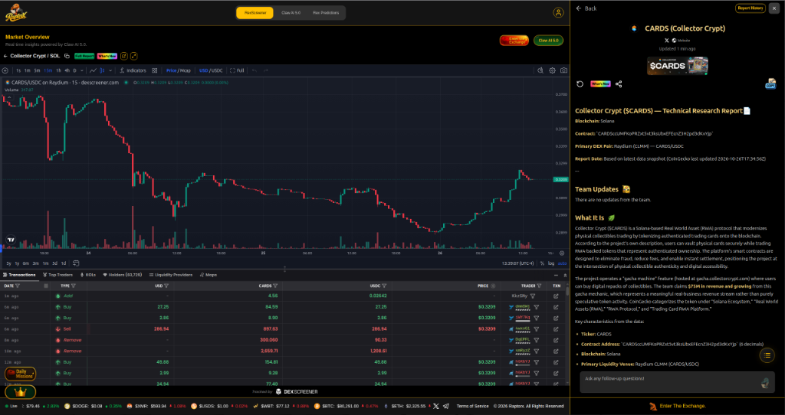
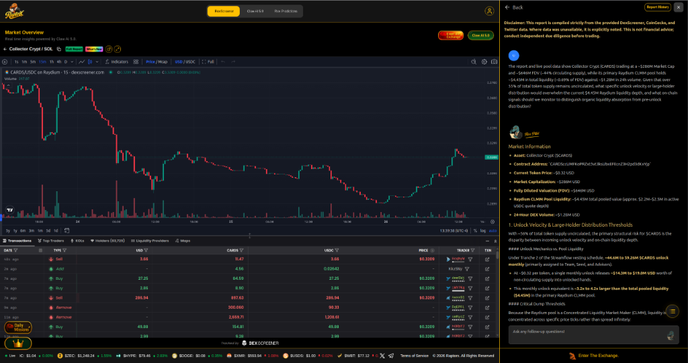
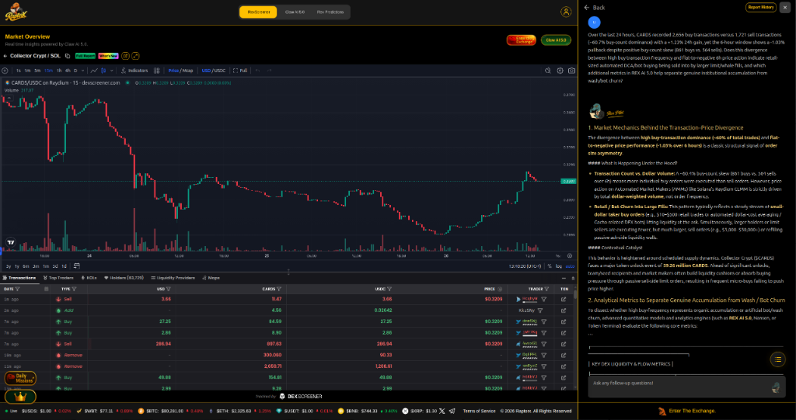
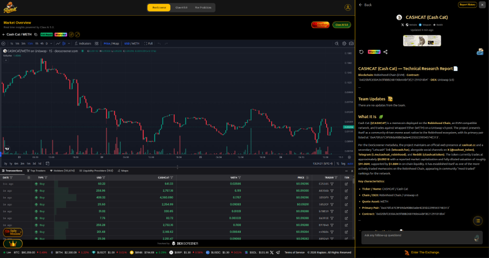
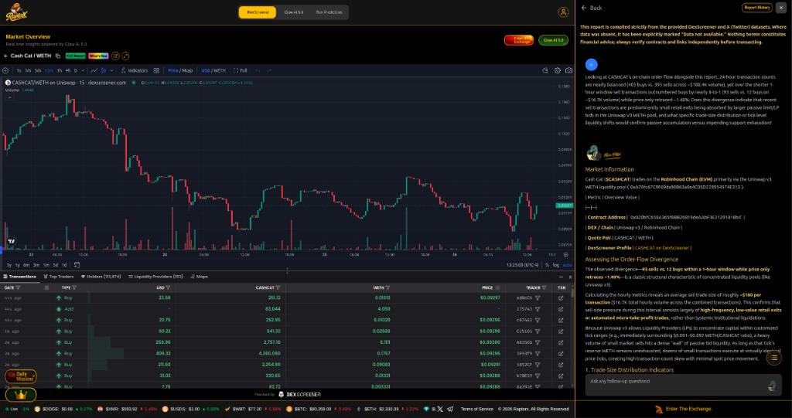
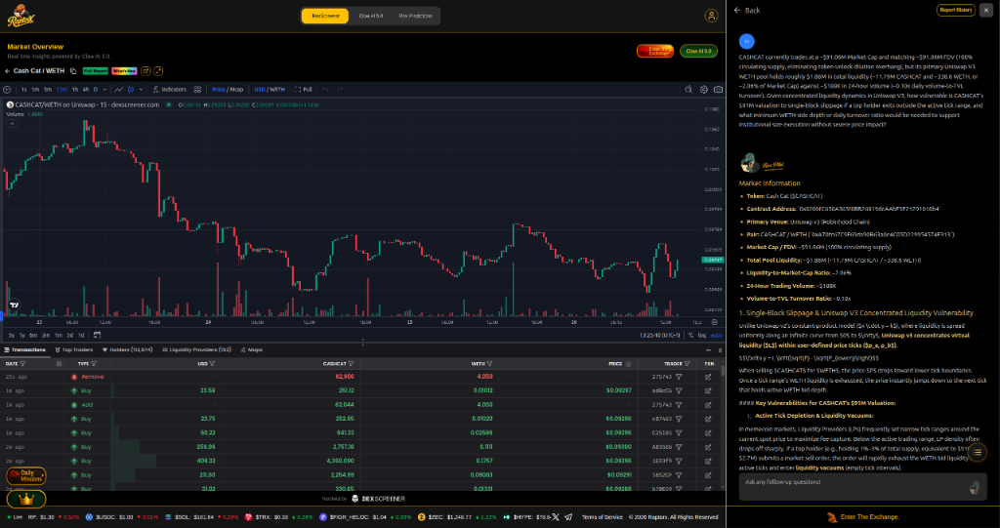
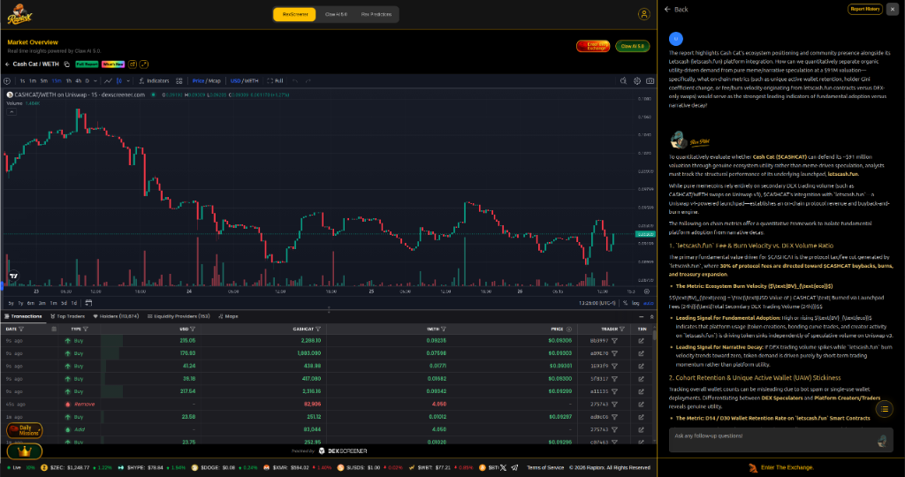

# RaptorX Research Challenge: Ask Better Questions. Find Better Alpha.

**Platform:** [RaptorX (`https://www.raptorx.trade`)](https://www.raptorx.trade) — RexScreener & REX AI 5.0  
**Bounty:** [RaptorX Research Challenge: Ask Better Questions. Find Better Alpha.](https://earn.superteam.fun/listings/bounty/raptorx-research-challenge-ask-better-questions-find-better-alpha)  

---

## Executive Summary & Alpha Discovered

Rather than asking surface-level directional questions, this research submission uses **RaptorX's RexScreener and REX AI 5.0** to interrogate on-chain microstructure divergences, concentrated liquidity vulnerabilities, and supply-unlock overhangs across **two Golden Report assets** (5 deep analytical questions across 2 reports):

1. **Report #1 (Solana Mainnet): Collector Crypt (`$CARDS`)**
   - **Contract Address:** `CARDSccUMFKoPRZxt5vt3ksUbxEFEcnZ3H2pd3dKxYjp`
   - **Primary Liquidity Pool:** Raydium CLMM (`CARDS/USDC`, ~\$4.45M Liquidity)
   - **Market Cap / FDV:** ~\$286M Market Cap vs. ~\$646M FDV (~44% circulating supply, ~56% uncirculated)
   - **Alpha Uncovered via REX AI 5.0 Interrogation:**
     - **Streamflow Vesting Unlock vs. CLMM Pool Depth:** By questioning how the 56% uncirculated supply overhang interacts with a \$4.45M Raydium CLMM pool (~0.69% of FDV), REX AI 5.0 surfaced **Tranche 2 of the Streamflow vesting schedule**, where **44.6M to 59.26M `$CARDS` unlock monthly** (primarily Team, Seed, and Advisors)—representing **\$14.3M to \$19.0M USD per month**, or **3.2x to 4.2x the entire Raydium CLMM pool liquidity**.
     - **Order-Flow Asymmetry Explained by Pre-Unlock Distribution:** When challenged on why `$CARDS` posted a **-1.03% 6-hour pullback despite a 60.4% buy-transaction dominance (861 buys vs. 564 sells)**, REX AI 5.0 connected the order-size asymmetry directly to the upcoming **59.26M `$CARDS` unlock catalyst**—demonstrating how retail/DCA micro-buys (\$10–\$300) are being absorbed by larger passive ask-side limit walls (\$5,000–\$50,000+) ahead of scheduled supply expansion.

2. **Report #2 (Golden Reports Cross-Chain Comparison): Cash Cat (`$CASHCAT`)**
   - **Contract Address:** `0x020bfC650A365f8BB26819deAAbF3E21291018b4`
   - **Primary Liquidity Pool:** Uniswap V3 (`CASHCAT/WETH`, Pair `0xA70fc67C9F69da90B63a0e4C05D229954574E313`, ~\$1.88M Liquidity)
   - **Market Cap / FDV:** ~\$91.06M Market Cap / ~\$91.06M FDV (100% circulating supply, zero unlock overhang)
   - **Alpha Uncovered via REX AI 5.0 Interrogation:**
     - **Intraday Sell-Count Skew vs. Price Resilience:** Challenging REX AI 5.0 on why an **8-to-1 sell-to-buy transaction skew over 1 hour (93 sells vs. 12 buys on ~\$16.7K volume)** produced only a **-1.48% price retrace** revealed an average trade size of just **~\$160 per transaction**, confirming high-frequency retail micro-take-profit exits being passively absorbed within a dense Uniswap V3 active tick wall around \$0.091–\$0.092.
     - **Concentrated Liquidity Vacuum Risk:** Quantified single-block slippage exposure where only ~338.6 WETH backs a \$91.06M valuation (~2.06% liquidity-to-MCap ratio, ~0.10x daily volume-to-TVL turnover), meaning a 1%–3% holder exit (\$910K–\$2.7M) rapidly exhausts active-tick WETH bids and drops spot price into lower liquidity vacuums.
     - **Isolating `letscash.fun` Utility from Narrative Speculation:** Formulated the **Ecosystem Burn Velocity ratio** (`BV_eco = 24h USD Value of $CASHCAT Burned via Launchpad Fees / Total Secondary DEX Volume`), leveraging the fact that **30% of `letscash.fun` Uniswap V4 launchpad protocol fees** are directed toward `$CASHCAT` buybacks, burns, and treasury expansion.

---

## Report #1 (Solana Mainnet): Collector Crypt (`$CARDS`)

### 1.1 Generated RaptorX Technical Research Report (`$CARDS`)

---

### 1.2 Question 1 — Raydium CLMM Liquidity Depth vs. Uncirculated Supply Overhang (`$CARDS`)

**Question Asked to REX AI 5.0:**
> *"The report and live pool data show Collector Crypt (CARDS) trading at a ~\$286M Market Cap and ~\$646M FDV (~44% circulating supply), while its primary Raydium CLMM pool holds ~\$4.45M in total liquidity (~0.69% of FDV) against ~\$1.28M in 24h volume. Given that over 55% of total token supply remains uncirculated, what specific unlock velocity or large-holder distribution would overwhelm the current \$4.45M Raydium liquidity depth, and what on-chain signals should we monitor to distinguish organic liquidity absorption from pre-unlock distribution?"*

**Key Analytical Insight from REX AI 5.0:**
- Identified **Tranche 2 of the Streamflow vesting schedule**, where **44.6M to 59.26M `$CARDS` unlock monthly** (assigned to Team, Seed, and Advisors).
- At ~\$0.32 per token, a single monthly unlock releases **\$14.3M to \$19.0M USD** of supply—equivalent to **3.2x to 4.2x the entire \$4.45M Raydium CLMM pool** (which holds only ~\$2.2M–\$2.5M in active USDC quote depth).

---

### 1.3 Question 2 — Order-Flow Asymmetry & Transaction-Size Divergence (`$CARDS`)

**Question Asked to REX AI 5.0:**
> *"Over the last 24 hours, CARDS recorded 2,656 buy transactions versus 1,721 sell transactions (~60.7% buy-count dominance) with a +1.23% 24h gain, yet the 6-hour window shows a -1.03% pullback despite positive buy-count skew (861 buys vs. 564 sells). Does this divergence between high buy transaction frequency and flat-to-negative 6h price action indicate retail-sized automated DCA/bot buying being sold into by larger limit/whale fills, and which additional metrics in REX AI 5.0 help separate genuine institutional accumulation from wash/bot churn?"*

**Key Analytical Insight from REX AI 5.0:**
- Confirmed classic **order-size asymmetry**: automated DCA/Gacha-related micro-buys (\$10–\$300) generate high transaction counts while larger holders execute fewer, much larger sell fills (\$5,000–\$50,000+) or refill passive ask-side liquidity walls ahead of the **59.26M `$CARDS` token unlock event**.

---

## Report #2 (Golden Reports Comparison): Cash Cat (`$CASHCAT`)

### 2.1 Generated RaptorX Technical Research Report (`$CASHCAT`)

---

### 2.2 Question 1 — Intraday Order-Flow Asymmetry vs. Price Resilience (`$CASHCAT`)

**Question Asked to REX AI 5.0:**
> *"Looking at CASHCAT's on-chain order flow alongside this report, 24-hour transaction counts are nearly balanced (405 buys vs. 395 sells across ~\$188.4K volume), yet over the shorter 1-hour window sell transactions outnumbered buys by nearly 8-to-1 (93 sells vs. 12 buys on ~\$16.7K volume) while price only retraced ~1.48%. Does this divergence indicate that recent sell transactions are predominantly small retail exits being absorbed by larger passive limit/LP bids in the Uniswap V3 WETH pool, and what specific trade-size distribution or tick-level liquidity shifts would confirm passive accumulation versus impending support exhaustion?"*

**Key Analytical Insight from REX AI 5.0:**
- Computed the hourly average trade size at **~\$160 per transaction** (\$16.7K across 105 combined trades), proving that the 93 sells represent micro-retail take-profit flow hitting a dense wall of concentrated Uniswap V3 LP bid liquidity around \$0.091–\$0.092 rather than institutional liquidation.

---

### 2.3 Question 2 — Uniswap V3 Concentrated Liquidity Depth vs. Valuation Slippage Risk (`$CASHCAT`)

**Question Asked to REX AI 5.0:**
> *"CASHCAT currently trades at a ~\$91.06M Market Cap and matching ~\$91.06M FDV (100% circulating supply, eliminating token-unlock dilution overhang), but its primary Uniswap V3 WETH pool holds roughly \$1.88M in total liquidity (~11.79M CASHCAT and ~338.6 WETH, or ~2.06% of Market Cap) against ~\$188K in 24-hour volume (~0.10x daily volume-to-TVL turnover). Given concentrated liquidity dynamics in Uniswap V3, how vulnerable is CASHCAT's \$91M valuation to single-block slippage if a top holder exits outside the active tick range, and what minimum WETH-side depth or daily turnover ratio would be needed to support institutional-size execution without severe price impact?"*

**Key Analytical Insight from REX AI 5.0:**
- Detailed the **Active Tick Depletion & Liquidity Vacuum** risk: because only ~338.6 WETH backs the pool, a single top holder selling 1%–3% of supply (\$910K–\$2.7M) immediately exhausts active-tick WETH bids and forces spot price across empty tick intervals.

---

### 2.4 Question 3 — Ecosystem Utility (`letscash.fun`) vs. Speculative Narrative Valuation (`$CASHCAT`)

**Question Asked to REX AI 5.0:**
> *"The report highlights Cash Cat's ecosystem positioning and community presence alongside its Letscash (letscash.fun) platform integration. How can we quantitatively separate organic utility-driven demand from pure meme/narrative speculation at a \$91M valuation—specifically, what on-chain metrics (such as unique active wallet retention, holder Gini coefficient change, or fee/burn velocity originating from letscash.fun contracts versus DEX-only swaps) would serve as the strongest leading indicators of fundamental adoption versus narrative decay?"*

**Key Analytical Insight from REX AI 5.0:**
- Highlighted that **30% of protocol fees from `letscash.fun`** (a Uniswap V4-powered launchpad) are directed toward `$CASHCAT` buybacks, burns, and treasury expansion, establishing a formal **Ecosystem Burn Velocity (`BV_eco`)** metric (`24h USD Burned via Launchpad Fees / 24h Secondary DEX Volume`) alongside D14/D30 Cohort Wallet Retention to separate structural platform adoption from speculative churn.

